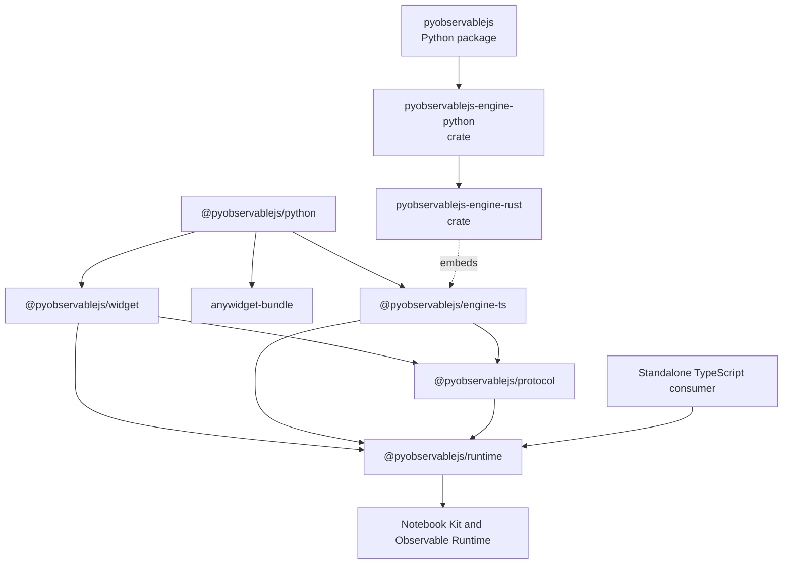

# Workspace

[Pixi](https://pixi.prefix.dev/) provides the system tools and runs every
repository task. Three language workspaces sit beside it:
[pnpm workspaces](https://pnpm.io/workspaces) for TypeScript packages,
[uv workspaces](https://docs.astral.sh/uv/concepts/projects/workspaces/) for the
Python distribution, and a [Cargo workspace](https://doc.rust-lang.org/cargo/reference/workspaces.html)
for the native engine.

```text
pixi.toml, pixi.lock      system tools, Python interpreters, and tasks
package.json, pnpm-*      TypeScript workspace: packages/*, apps/*
pyproject.toml, uv.lock   Python workspace: packages/pyobservablejs
Cargo.toml, Cargo.lock    Rust workspace: packages/engine-rust, packages/engine-python
```

Every library lives in `packages/`, and `apps/` holds the docs site and the
end-to-end tests. A package's directory matches its name after the
`@pyobservablejs/` npm scope or the `pyobservablejs-` crate prefix. The engine
splits into `engine-ts` for the TypeScript service, `engine-rust` for the V8
host, and `engine-python` for the Python extension.

## Package graph



| Package                   | Contract                                                                                                 |
| ------------------------- | -------------------------------------------------------------------------------------------------------- |
| `packages/runtime`        | Source-to-DOM mounting, analysis, execution, native values, input controls, styles, and evaluation state |
| `packages/widget`         | anywidget model resolution, shared-input transport, and readback publication                             |
| `packages/protocol`       | Python value codecs, exact read contracts, and Chromium response frames                                  |
| `packages/engine-ts`      | Headless command service, the embedded V8 bundle, and the Chromium page entry                            |
| `anywidget-bundle`        | Vite plugin, manifest, module transport, lifecycle protocol, and Python response runtime                 |
| `packages/engine-rust`    | Rust `Engine`: V8 isolates, host operations, module loading, network policy, and module cache            |
| `packages/engine-python`  | PyO3 extension `observablejs._engine` over the engine crate                                              |
| `packages/pyobservablejs` | Python API, traitlets, build backend, native and pure wheels, and sdist                                  |
| `apps/e2e`                | Standalone TypeScript, marimo, JupyterLab, and Pyodide tests                                             |
| `apps/docs`               | Docusaurus configuration, mdx-marimo integration, and published site build                               |

Solid arrows indicate imports from consumer to dependency. Cross-package
TypeScript imports use package names and internal dependencies use
`workspace:*`. `runtime` exposes `mountNotebook` and contract types at its root,
plus native value utilities at `/values`. The protocol package owns Python
serialization. Both adapters consume these entry points. Read the
[TypeScript API](../packages/runtime/README.md) for the mount contract.

The frontend pins the npm `anywidget-bundle` release. The Python distribution
requires the matching PyPI release as its floor. Shared external versions use the
catalog in `pnpm-workspace.yaml`.

## Toolchain

`pixi.toml` pins Node, pnpm, uv, Rust with Clippy and rustfmt, `cargo-deny`,
`cargo-shear`, `actionlint`, and Python 3.11 through 3.14. `pixi.lock` records
the resolved builds. The default environment uses Python 3.12 and `.venv`. The
`py311`, `py313`, and `py314` environments use `.venv-py311`, `.venv-py313`, and
`.venv-py314`. Activation points uv at the environment's interpreter and turns
off uv's own Python downloads. The platform C/C++ toolchain links the native
extension.

Pixi `exclude-newer`, pnpm `minimumReleaseAge`, and uv `exclude-newer` accept
releases at least three days old. `minimumReleaseAgeExclude` in
`pnpm-workspace.yaml` lists security patches published inside that window.

`pixi task list` shows every task. The main tasks:

| Task                                      | Runs                                                                  |
| ----------------------------------------- | --------------------------------------------------------------------- |
| `install`                                 | pnpm install, the JavaScript build, and `uv sync` with the extension  |
| `check-js`, `test-js`                     | Vite+ format, lint, and type checks, Knip, and TypeScript tests       |
| `check-python`, `test-python`             | `uv.lock` check, Ruff, ty, Pyrefly, and pytest                        |
| `check-rust`                              | rustfmt, Clippy, `cargo deny`, `cargo shear`, and Rust tests          |
| `build`, `build-pure`                     | The sdist and a native wheel from it, and the pure wheel              |
| `test-e2e`, `test-pyodide`, `test-floors` | Browser tests, the pure wheel in Pyodide, and dependency lower bounds |
| `docs`, `docs-serve`                      | The documentation build and its local preview                         |
| `check`                                   | Every check, test, build, and docs task except `test-floors`          |

The root `vite.config.ts` configures Vite+ formatting, linting, type checks, and
task caching for TypeScript, Markdown, and TOML. Package-local Vite configs own
tests and build behavior.

The root manifest leaves the Node module type unset. JupyterLab runs CommonJS
helper scripts from the repository-local Python environment, and Node resolves
their module type through ancestor manifests. Each TypeScript workspace package
declares its own ESM boundary. The root `package.json` declares the pnpm version
that Pixi installs, and requires Node 22.18 or newer.

The root `pyproject.toml` defines a virtual uv workspace. The project metadata,
Maturin configuration, and Hatch configuration live in
`packages/pyobservablejs/pyproject.toml`. The root `dev` group owns
repository-wide Python tools: Ruff, ty, pytest, Pyrefly, marimo, and Jupyter.
The `apps/docs` package owns Docusaurus and mdx-marimo. The Python package `dev`
group owns Hatchling, Maturin, and watchfiles.

The root `Cargo.toml` is a virtual Cargo workspace. It owns shared dependency
versions, lints, and the release profile. Crates inherit them with
`workspace = true`. `rustfmt.toml` sets formatting, `clippy.toml` allows
`unwrap`, `expect`, and `panic` in tests, and `deny.toml` sets the license,
advisory, ban, and source policy.

## Native engine build

`deno_core` links a prebuilt [rusty_v8](https://github.com/denoland/rusty_v8)
static library. `packages/pyobservablejs/native-archives.json` pins the archive
and its generated bindings for each target by URL, byte size, and SHA-256
digest. `native_build.py` checks the locked V8 version and features, downloads
and verifies the files into `CARGO_HOME/pyobservablejs-v8`, and remaps build
paths in the extension. Pixi's Rust tasks run Cargo through it:

```sh
pixi run python packages/pyobservablejs/native_build.py cargo test --workspace --locked --exclude pyobservablejs-engine-python
```

The PEP 517 backend in `build_backend.py` checks the frontend assets, runs the
same V8 check, delegates to [Maturin](https://www.maturin.rs/) with
`manifest-path = "../engine-python/Cargo.toml"`, and attaches
the Agent Plugin.

`@pyobservablejs/engine-ts` writes its V8 bundle to
`packages/engine-rust/bundle/`. The engine crate's `build.rs` embeds
every chunk there, served as `pyobservablejs:/<file>.js`, and the `deno_web`
and `deno_webidl` sources, located through `cargo metadata`.

## Build artifacts

`pixi run build` builds the JavaScript workspace and writes the sdist and a
native wheel built from it to `dist/`. `pixi run build-pure` writes the pure
wheel to `dist/pure/`.

| Artifact     | Builder | Tag                     | Contents                                                               |
| ------------ | ------- | ----------------------- | ---------------------------------------------------------------------- |
| Native wheel | Maturin | `cp311-abi3-<platform>` | Python package, widget and Chromium assets, `_engine`                  |
| Pure wheel   | Hatch   | `py3-none-any`          | Python package, widget and Chromium assets                             |
| sdist        | Maturin | source                  | Python sources, both crates, Cargo workspace files, bundle, and assets |

Maturin roots the sdist at the Cargo workspace and moves `pyproject.toml` beside
the workspace `Cargo.toml`. The `abi3-py311` target uses CPython's stable ABI,
so one native wheel per platform covers Python 3.11 and newer. Both wheels carry
the Agent Plugin. `hatch_build.py` checks the widget assets before Hatch
packages the pure wheel. Rebuilding a native wheel from the sdist needs Rust and
network access for Cargo dependencies and the verified V8 inputs. It needs no
JavaScript workspace.

`vp pack` writes each TypeScript library to its package-local `dist/` directory.
The Python workspace package runs `vp build`, writes the deployable widget to
`packages/pyobservablejs/src/observablejs/static/`, then runs
`scripts/stage-chromium.mjs`, which copies the Chromium page to
`static/chromium/`.

`wheels.yml` builds native wheels for Linux x86_64 and aarch64 in manylinux 2.28
containers with the Rust release locked in `pixi.lock`, macOS arm64 and x86_64
with a macOS 12 deployment target, and Windows x86_64. It verifies each
installed wheel on Python 3.11 and 3.14, the pure wheel in an isolated
environment and in Pyodide, and a native wheel rebuilt from the sdist. CI and
the publish workflow both call it.

`pixi run test-floors` installs a native wheel on Python 3.11 with every runtime
requirement at its declared lower bound and runs the Python tests. Keep runtime
requirements as plain `name>=version` floors.

Run the cross-language gate:

```sh
pixi run check
```
